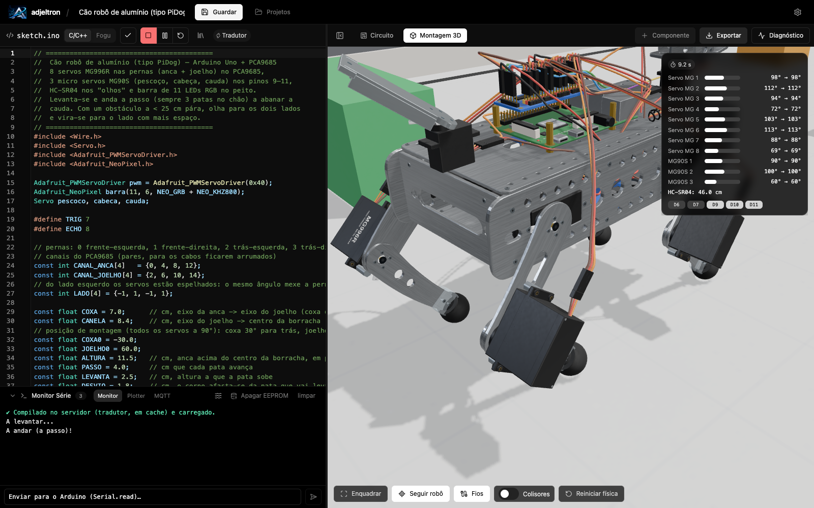
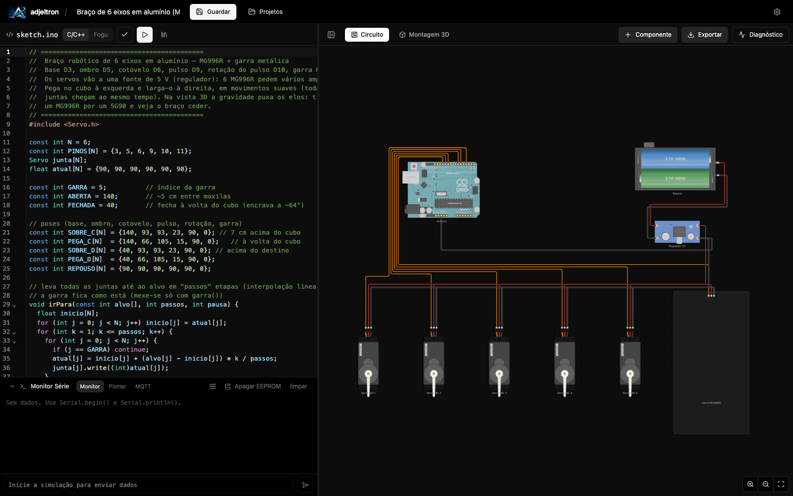
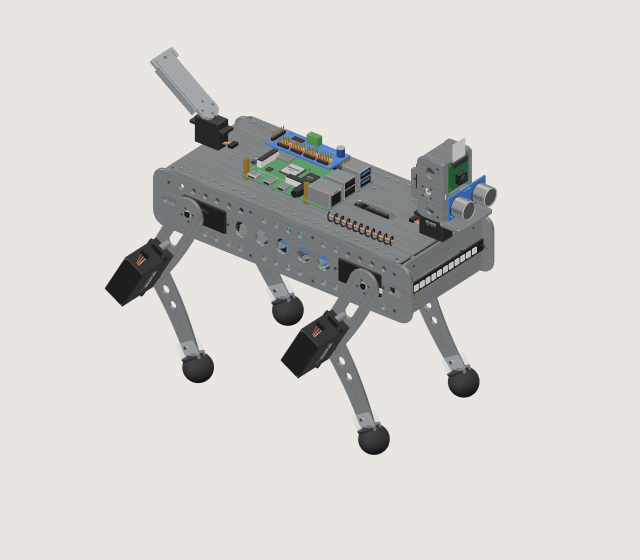
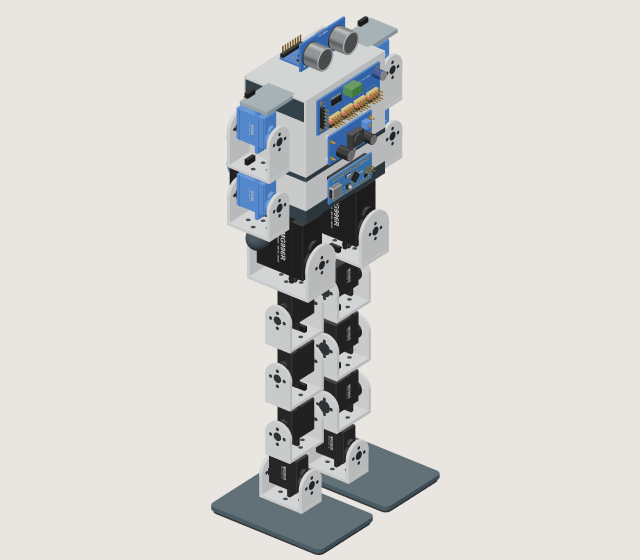
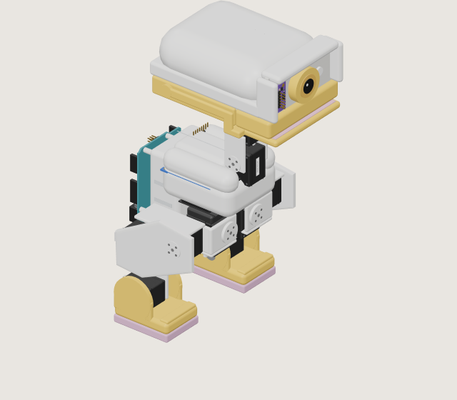
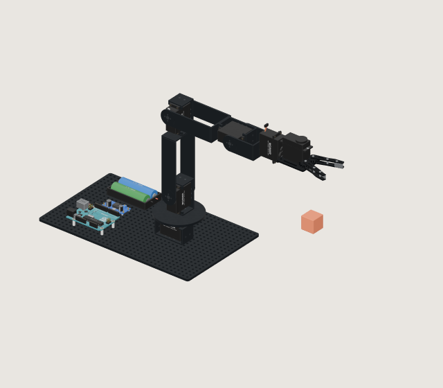
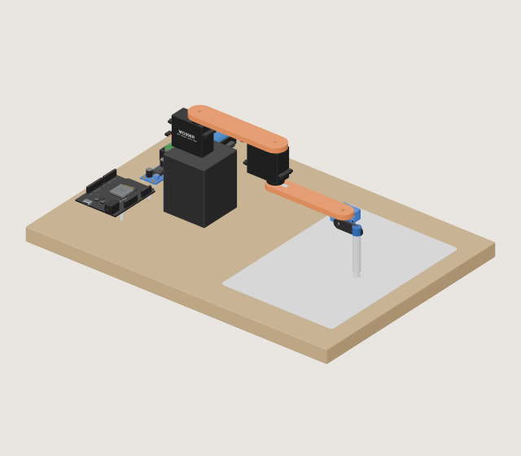
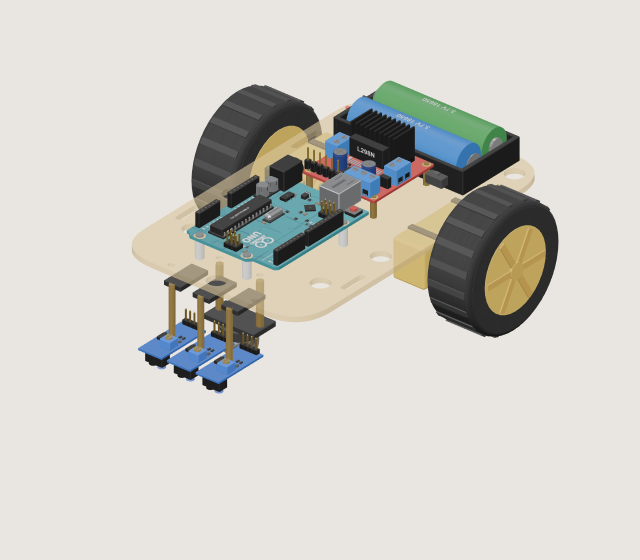

# adjeltron

**Bancada virtual de eletrónica e robótica** — monte o circuito em 2D, a mecânica em 3D com física,
programe em **C/C++ (Arduino)** ou **Fogu** e veja tudo a funcionar antes de tocar num componente.

[**⬇ Descarregar a última versão**](../../releases/latest)

---

## ⬇ Descarregar

| Sistema | Ficheiro |
|---|---|
| **Windows 10/11** (64 bits) | `adjeltron_x.y.z_x64-setup.exe` (ou `.msi`) |
| **macOS 11+** (Apple Silicon e Intel) | `adjeltron_x.y.z_universal.dmg` |

Todos os ficheiros estão em [**Releases**](../../releases/latest).

> **macOS:** a app ainda não é notarizada pela Apple. Na primeira abertura (e a cada versão nova),
> vá a **Definições do Sistema → Privacidade e Segurança → Abrir mesmo assim**.
> Ou, no Terminal: `xattr -dr com.apple.quarantine /Applications/adjeltron.app`
>
> **Windows:** se o SmartScreen avisar, carregue em **Mais informações → Executar mesmo assim**.

A app traz tudo dentro: o simulador, o compilador rápido, o broker MQTT local e as bibliotecas.
Para compilar com o **avr-gcc verdadeiro** (erros reais da placa e emulação do ATmega328P),
basta ter o [Arduino IDE 2](https://www.arduino.cc/en/software) instalado.

## ✨ O que faz

- 🔌 **Circuito 2D**: fios pino a pino, breadboards e diagnóstico (curtos, LED sem resistência, pinos a flutuar)
- 🦾 **Montagem 3D com física**: servos com binário real, motores, engrenagens, correias, gravidade e colisões
- ⚡ **Eletrónica simulada**: transístores, MOSFETs, amp-ops, reguladores, LEDs que queimam
- 💻 **C/C++ Arduino** e 🔥 **Fogu**, com realce, erros ao escrever e bibliotecas do utilizador
- 📡 **IoT**: WiFi, HTTP e MQTT no ESP32 e no Pico W
- 📊 **Ferramentas**: Monitor Série, Plotter, osciloscópio e telemetria dos servos

**339 componentes · 13 placas · 111 exemplos · 120+ bibliotecas Arduino**

## 🤖 Exemplos

| | | |
|:---:|:---:|:---:|
|  **Cão robô**: 11 servos, PCA9685, sonar |  **Humanoide**: 14 servos, MPU6050, equilíbrio |  **Pato bípede**: 15 servos, ToF |
|  **Braço de 6 eixos**: pega e larga um cubo |  **Braço SCARA**: escreve "OLA" com caneta |  **Seguidor de linha**: 3 sensores IR, L298N |

**Placas:** Arduino Uno, Nano e Mega · ESP32 · Raspberry Pi Pico, Pico W, Pico 2 e Pico 2 W · Nano RP2040 ·
ATtiny85 e Franzininho · STM32 Blue Pill.

## 🐞 Problemas e sugestões

Abra uma [Issue](../../issues) com a versão, o sistema operativo e, se possível, o projeto exportado (`.adjel`).
